

<picture>
  <source media="(prefers-color-scheme: dark)" srcset="assets/v2/hero-dark.webp" />
  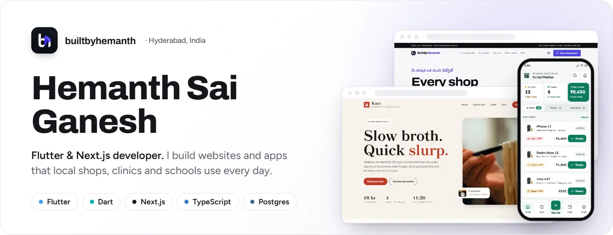
</picture>

  
  <a href="https://builtbyhemanth.com/showroom">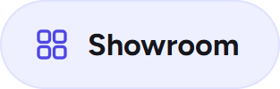</a>
  
  
  

### About

- I run **[Builtby Hemanth](https://builtbyhemanth.com)**: websites, booking systems and apps for local businesses in Hyderabad and Andhra Pradesh.
- I build mobile apps in **Flutter**, and websites and admin panels in **Next.js + TypeScript** on **Postgres**.
- I also build ERPs: billing, stock, clinic and staff software.
- Everything is phone-first, fast, and sends enquiries straight to WhatsApp.

### What I'm building

<picture>
  <source media="(prefers-color-scheme: dark)" srcset="assets/v2/feature-dark.webp" />
  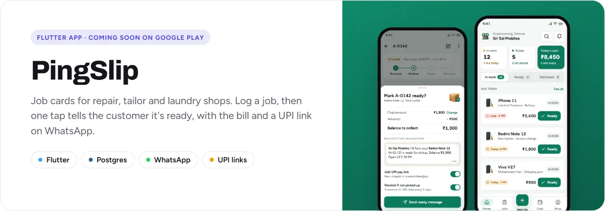
</picture>

  <a href="https://pilupu-two.vercel.app"><picture><source media="(prefers-color-scheme: dark)" srcset="assets/v2/pilupu-dark.jpg" />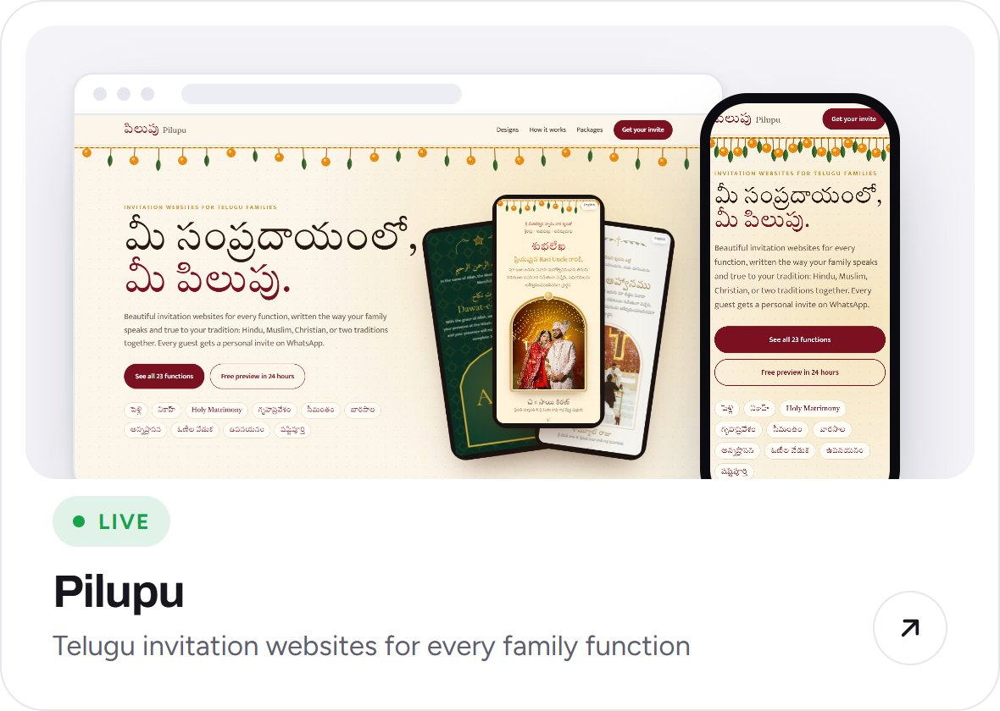</picture></a>
  <a href="https://builtbyhemanth.com/showroom"><picture><source media="(prefers-color-scheme: dark)" srcset="assets/v2/showroom-dark.jpg" />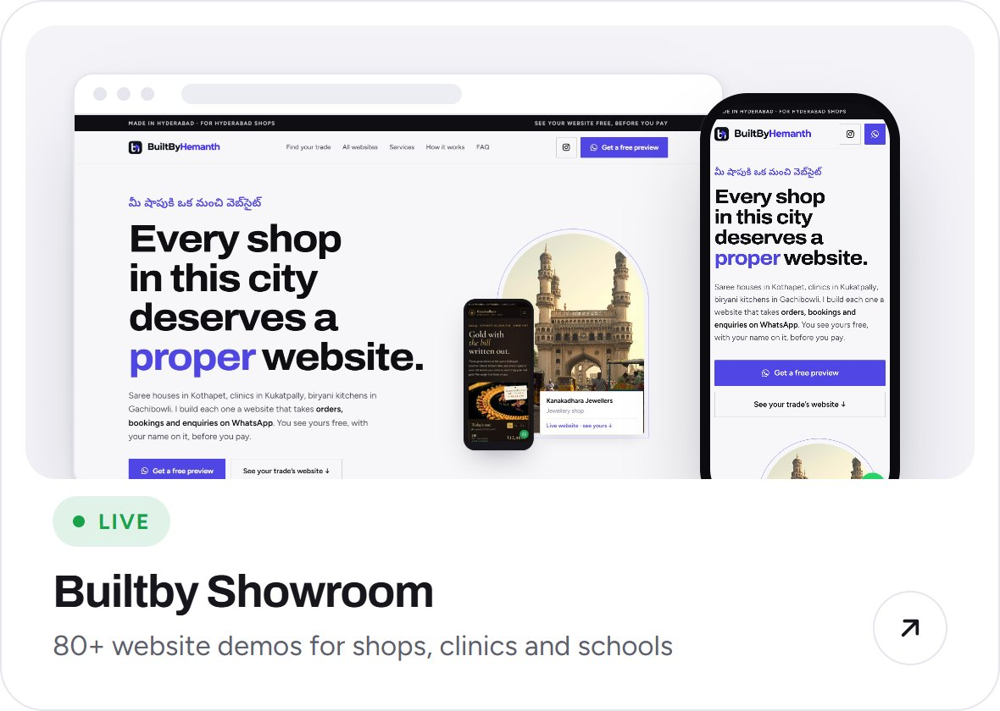</picture></a>

### Recent websites

  <a href="https://ramen-demo-builtby.vercel.app"><picture><source media="(prefers-color-scheme: dark)" srcset="assets/v2/ramen-dark.jpg" />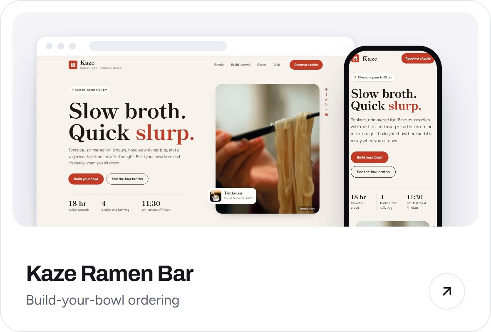</picture></a>
  <a href="https://optical-demo-builtby.vercel.app"><picture><source media="(prefers-color-scheme: dark)" srcset="assets/v2/drishti-dark.jpg" />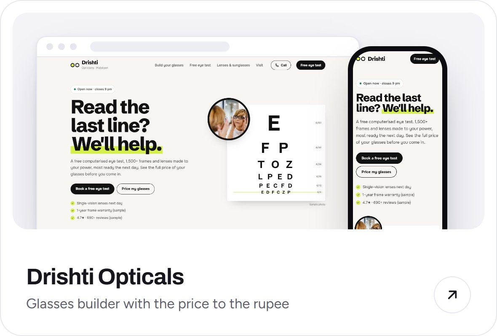</picture></a>
  <a href="https://photo-demo-builtby.vercel.app"><picture><source media="(prefers-color-scheme: dark)" srcset="assets/v2/chitra-dark.jpg" />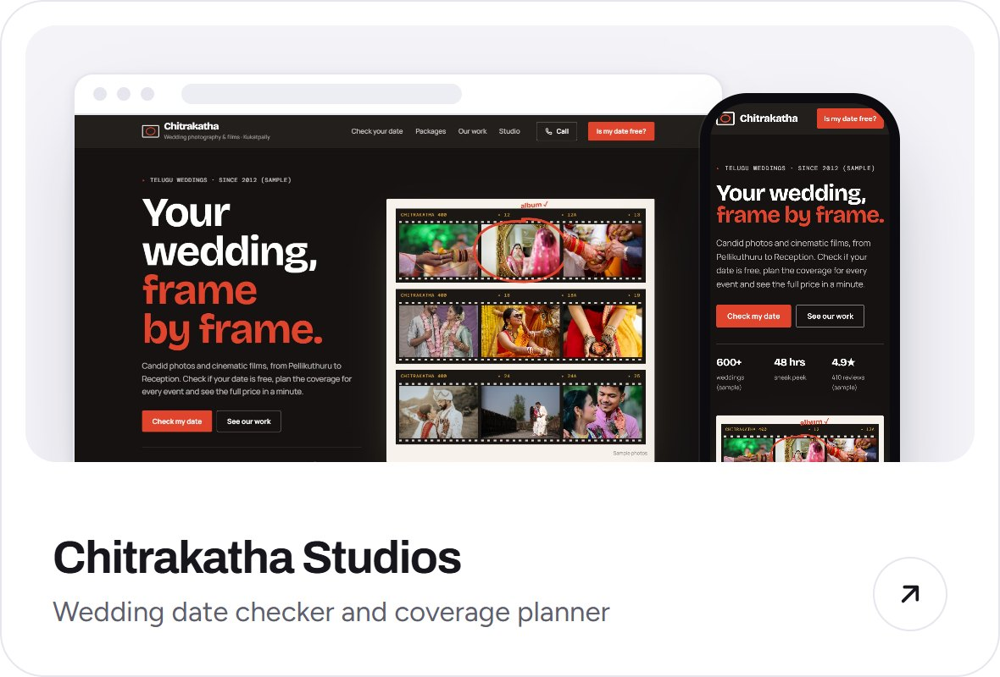</picture></a>
  <a href="https://sports-demo-builtby.vercel.app"><picture><source media="(prefers-color-scheme: dark)" srcset="assets/v2/sixer-dark.jpg" />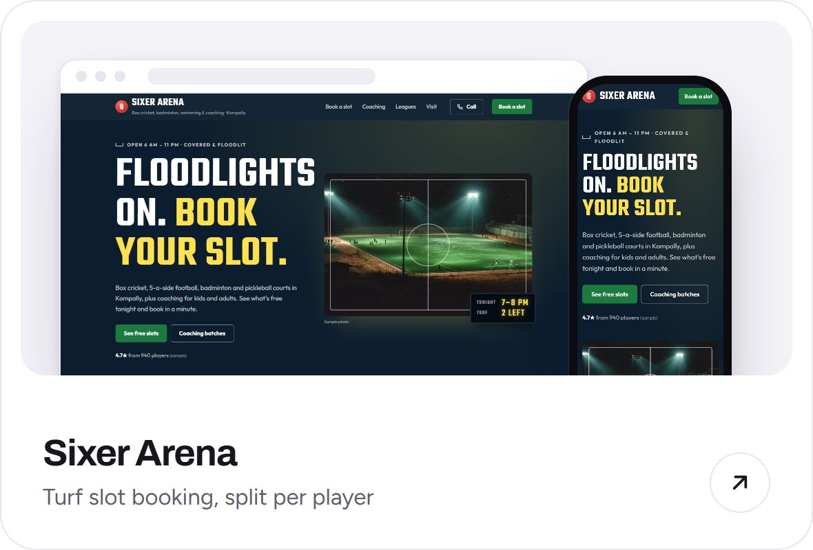</picture></a>
  <a href="https://sweets-demo-builtby.vercel.app"><picture><source media="(prefers-color-scheme: dark)" srcset="assets/v2/madhuram-dark.jpg" />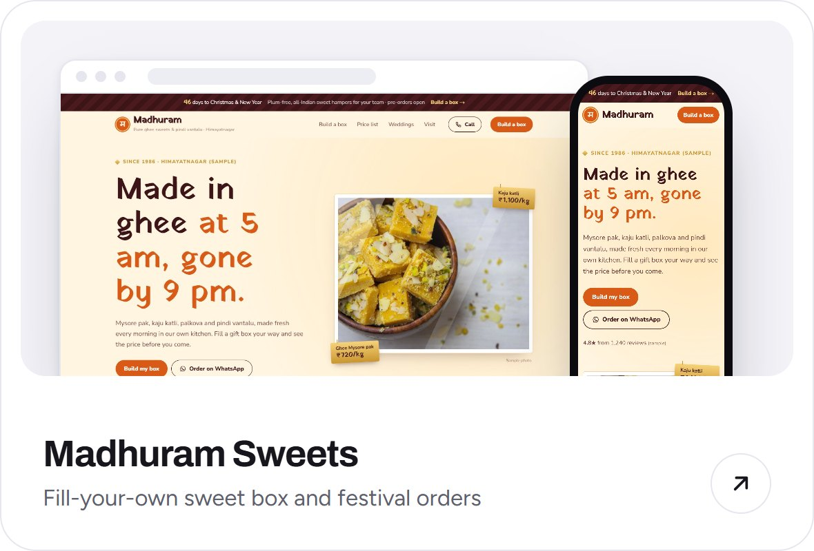</picture></a>
  <a href="https://kanakadhara-jewellers.vercel.app"><picture><source media="(prefers-color-scheme: dark)" srcset="assets/v2/kanaka-dark.jpg" />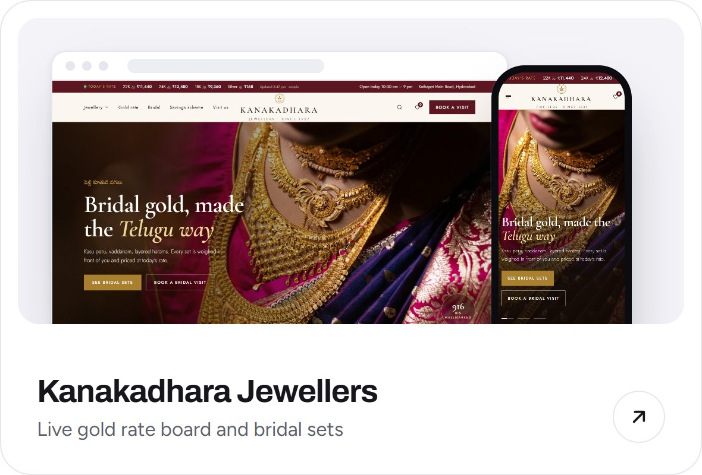</picture></a>

<a href="https://builtbyhemanth.com/showroom"><b>See all 80+ demos in the showroom →</b></a>

### Tech

  

<picture>
  <source media="(prefers-color-scheme: dark)" srcset="https://raw.githubusercontent.com/builtbyhemanth/builtbyhemanth/output/snake-dark.svg" />
  
</picture>

